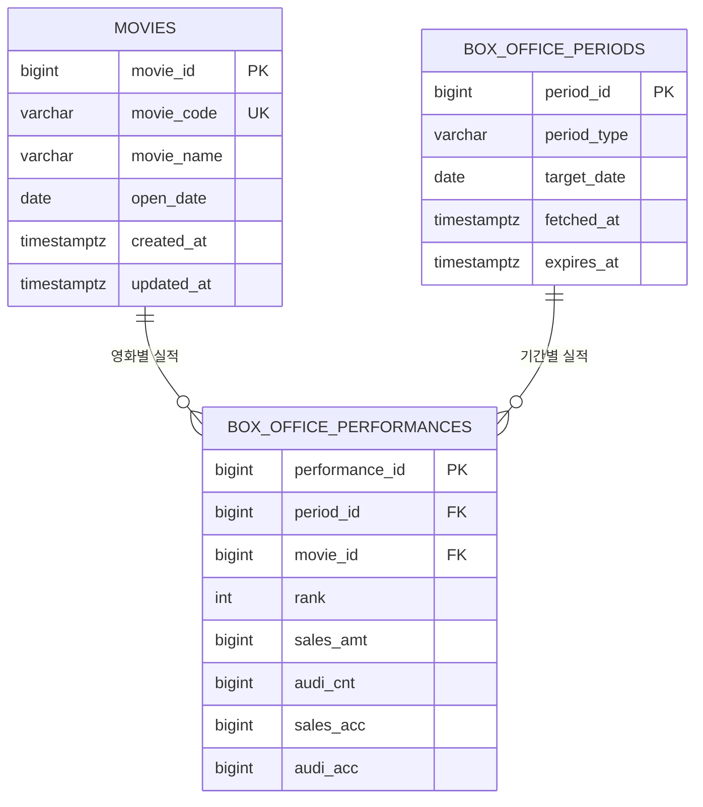
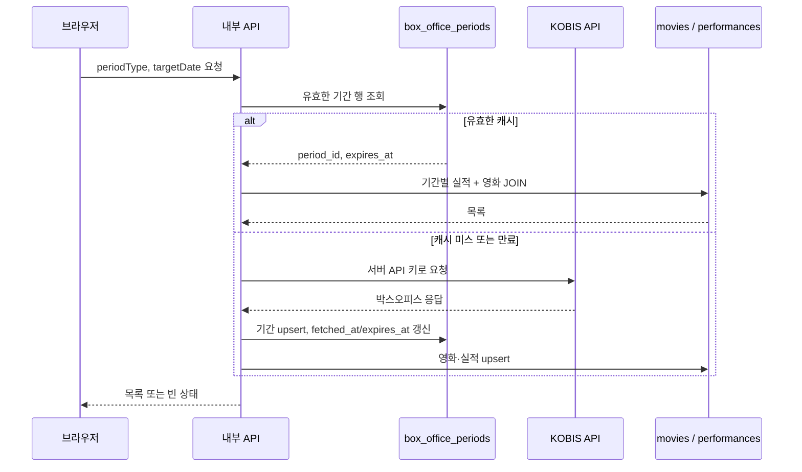

# ERD: 박스오피스 데이터 저장 설계

## 1. 저장할 데이터

KOBIS 박스오피스 응답을 조회 기간별로 저장한다. 숫자 값은 API에서 문자열로 오더라도 저장 전에 숫자형으로 변환·검증한다.

| 구분 | 저장 데이터 | 출처 필드 | 권장 타입 |
| --- | --- | --- | --- |
| 영화 정보 | 영화 코드, 영화명, 개봉일 | `movieCd`, `movieNm`, `openDt` | `movie_code VARCHAR`, `movie_name VARCHAR`, `open_date DATE NULL` |
| 조회 기간 | 기간 유형, 기준일 | 내부 요청의 `periodType`, `targetDt` | `period_type VARCHAR`, `target_date DATE` |
| 기간별 영화 실적 | 순위, 매출, 관객 수, 누적 매출, 누적 관객 수 | `rank`, `salesAmt`, `audiCnt`, `salesAcc`, `audiAcc` | `rank INTEGER`, 금액·관객 수 `BIGINT` |

## 2. 하나의 표에 모두 저장할 때의 문제

모든 데이터를 `box_office_records(movie_code, movie_name, open_date, period_type, target_date, rank, sales_amt, audi_cnt, sales_acc, audi_acc)` 한 표에 넣으면 같은 영화 정보가 조회 기간마다 반복된다.

| 이상 유형 | 발생 예시 | 문제 |
| --- | --- | --- |
| 삽입 이상 | 아직 박스오피스 실적이 없는 영화를 미리 등록하고 싶다. | 기간·순위·매출 같은 실적 값이 없어서 영화 정보만 저장하기 어렵거나, 의미 없는 임시 값을 넣어야 한다. |
| 수정 이상 | 영화명이 정정되거나 개봉일이 바뀐다. | 그 영화가 등장한 모든 기간의 행을 수정해야 한다. 일부 행만 수정하면 같은 영화가 서로 다른 이름·개봉일로 표시된다. |
| 삭제 이상 | 특정 날짜의 박스오피스 데이터를 삭제한다. | 그 날짜에만 등장한 영화라면 실적 행과 함께 영화 코드·이름·개봉일 정보도 사라진다. |

따라서 영화 자체의 속성, 조회 기간의 속성, 두 정보를 연결하는 실적을 분리한다.

## 3. 정규화한 테이블 설계

### `movies` — 영화 정보

| 컬럼 | 타입 | 제약 | 설명 |
| --- | --- | --- | --- |
| `movie_id` | `BIGINT` | PK, 자동 생성 | 내부 영화 식별자 |
| `movie_code` | `VARCHAR(20)` | UNIQUE, NOT NULL | KOBIS `movieCd` |
| `movie_name` | `VARCHAR(255)` | NOT NULL | KOBIS `movieNm` |
| `open_date` | `DATE` | NULL 허용 | KOBIS `openDt`; 없거나 유효하지 않으면 `NULL` |
| `created_at` | `TIMESTAMPTZ` | NOT NULL | 최초 저장 시각 |
| `updated_at` | `TIMESTAMPTZ` | NOT NULL | 마지막 갱신 시각 |

### `box_office_periods` — 조회 기간

| 컬럼 | 타입 | 제약 | 설명 |
| --- | --- | --- | --- |
| `period_id` | `BIGINT` | PK, 자동 생성 | 내부 조회 기간 식별자 |
| `period_type` | `VARCHAR(10)` | NOT NULL, CHECK | `daily`, `weekly`, `weekend` 중 하나 |
| `target_date` | `DATE` | NOT NULL | KOBIS 호출의 기준일 |
| `fetched_at` | `TIMESTAMPTZ` | NOT NULL | KOBIS에서 정상 응답을 받은 시각 |
| `expires_at` | `TIMESTAMPTZ` | NOT NULL | 캐시 만료 시각 |

`UNIQUE (period_type, target_date)`로 같은 일간·주간·주말 조회 기간이 중복 저장되지 않게 한다.

### `box_office_performances` — 기간별 영화 실적

| 컬럼 | 타입 | 제약 | 설명 |
| --- | --- | --- | --- |
| `performance_id` | `BIGINT` | PK, 자동 생성 | 내부 실적 식별자 |
| `period_id` | `BIGINT` | FK → `box_office_periods.period_id`, NOT NULL | 어떤 조회 기간의 실적인지 |
| `movie_id` | `BIGINT` | FK → `movies.movie_id`, NOT NULL | 어떤 영화의 실적인지 |
| `rank` | `INTEGER` | NOT NULL, CHECK (`rank > 0`) | 기간 내 순위 |
| `sales_amt` | `BIGINT` | NOT NULL, CHECK (`sales_amt >= 0`) | 기간 매출액(원) |
| `audi_cnt` | `BIGINT` | NOT NULL, CHECK (`audi_cnt >= 0`) | 기간 관객 수(명) |
| `sales_acc` | `BIGINT` | NOT NULL, CHECK (`sales_acc >= 0`) | 누적 매출액(원) |
| `audi_acc` | `BIGINT` | NOT NULL, CHECK (`audi_acc >= 0`) | 누적 관객 수(명) |

`UNIQUE (period_id, movie_id)`로 같은 기간에 같은 영화 실적이 두 번 저장되는 것을 막고, `UNIQUE (period_id, rank)`로 한 기간에 같은 순위가 중복되는 것을 막는다.

## 4. 관계도



관계는 `movies` 1 : N `box_office_performances`, `box_office_periods` 1 : N `box_office_performances`이다. 즉, 영화와 조회 기간은 실적 테이블을 통해 N : M 관계를 이룬다.

## 5. 예시 데이터와 JOIN

### 가상 데이터

영화 2개와 일간 조회 날짜 3일의 예시다. 각 날짜의 일간 박스오피스에서 영화별 실적을 저장한다.

**`movies`**

| movie_id | movie_code | movie_name | open_date |
| ---: | --- | --- | --- |
| 1 | 20260001 | 별빛 탐정 | 2026-10-20 |
| 2 | 20260002 | 바다의 노래 | 2026-10-22 |

**`box_office_periods`**

| period_id | period_type | target_date |
| ---: | --- | --- |
| 101 | daily | 2026-10-21 |
| 102 | daily | 2026-10-22 |
| 103 | daily | 2026-10-23 |

**`box_office_performances`**

| period_id | movie_id | rank | sales_amt | audi_cnt | sales_acc | audi_acc |
| ---: | ---: | ---: | ---: | ---: | ---: | ---: |
| 101 | 1 | 1 | 120000000 | 12000 | 120000000 | 12000 |
| 102 | 1 | 1 | 100000000 | 10000 | 220000000 | 22000 |
| 102 | 2 | 2 | 80000000 | 8000 | 80000000 | 8000 |
| 103 | 1 | 2 | 70000000 | 7000 | 290000000 | 29000 |
| 103 | 2 | 1 | 110000000 | 11000 | 190000000 | 19000 |

### F1 목록 화면용 JOIN 예시

2026-10-23의 일간 박스오피스 목록을 조회하는 SQL이다.

```sql
SELECT
  p.target_date,
  p.period_type,
  f.rank,
  m.movie_code,
  m.movie_name,
  m.open_date,
  f.sales_amt,
  f.audi_cnt,
  f.sales_acc,
  f.audi_acc
FROM box_office_periods AS p
JOIN box_office_performances AS f
  ON f.period_id = p.period_id
JOIN movies AS m
  ON m.movie_id = f.movie_id
WHERE p.period_type = 'daily'
  AND p.target_date = DATE '2026-10-23'
ORDER BY f.rank ASC;
```

**조회 결과**

| 순위 | 영화명 | 개봉일 | 매출(원) | 관객 수(명) | 누적 관객 수(명) |
| ---: | --- | --- | ---: | ---: | ---: |
| 1 | 바다의 노래 | 2026-10-22 | 110,000,000 | 11,000 | 19,000 |
| 2 | 별빛 탐정 | 2026-10-20 | 70,000,000 | 7,000 | 29,000 |

### F2 인사이트 화면용 집계 예시

최근 3일간 영화별 매출·관객 합계를 구하려면 같은 JOIN 결과를 기간으로 묶는다.

```sql
SELECT
  m.movie_name,
  SUM(f.sales_amt) AS sales_total,
  SUM(f.audi_cnt) AS audience_total
FROM box_office_periods AS p
JOIN box_office_performances AS f
  ON f.period_id = p.period_id
JOIN movies AS m
  ON m.movie_id = f.movie_id
WHERE p.period_type = 'daily'
  AND p.target_date BETWEEN DATE '2026-10-21' AND DATE '2026-10-23'
GROUP BY m.movie_id, m.movie_name
ORDER BY sales_total DESC;
```

## 6. 기존 캐시 설계와 연결

`ARCHITECTURE.md`의 캐시 키인 `periodType + targetDate`는 이 설계의 `box_office_periods` 한 행과 정확히 대응한다. 즉, 별도의 JSON 캐시 테이블을 추가하지 않아도 `box_office_periods`와 그에 연결된 `box_office_performances`를 관계형 캐시로 사용할 수 있다.

| 기존 캐시 개념 | 관계형 테이블 매핑 | 역할 |
| --- | --- | --- |
| `cache_key` | `UNIQUE (period_type, target_date)` | 같은 조회 조건이 중복 저장되지 않게 하는 캐시 키 |
| `period_type` | `box_office_periods.period_type` | `daily` / `weekly` / `weekend` 구분 |
| `target_date` | `box_office_periods.target_date` | KOBIS 호출 기준일 |
| `items` | 해당 `period_id`의 `box_office_performances` + `movies` JOIN 결과 | 캐시된 영화 목록 |
| `fetched_at` | `box_office_periods.fetched_at` | 마지막 정상 KOBIS 수집 시각 |
| `expires_at` | `box_office_periods.expires_at` | 캐시 유효성 판단 시각 |

### 캐시 조회

예를 들어 `daily`, `2026-10-23` 요청이 들어오면 먼저 `box_office_periods`에서 유효한 기간을 찾고, 찾으면 실적과 영화를 JOIN해 즉시 반환한다.

```sql
SELECT
  p.period_id,
  p.fetched_at,
  p.expires_at,
  f.rank,
  m.movie_code,
  m.movie_name,
  m.open_date,
  f.sales_amt,
  f.audi_cnt,
  f.sales_acc,
  f.audi_acc
FROM box_office_periods AS p
LEFT JOIN box_office_performances AS f
  ON f.period_id = p.period_id
LEFT JOIN movies AS m
  ON m.movie_id = f.movie_id
WHERE p.period_type = 'daily'
  AND p.target_date = DATE '2026-10-23'
  AND p.expires_at > NOW()
ORDER BY f.rank ASC NULLS LAST;
```

`LEFT JOIN`을 사용하면 KOBIS가 정상적으로 빈 배열을 준 경우에도 `box_office_periods` 행은 반환된다. 서버는 이를 오류가 아닌 **정상 빈 캐시**로 판단할 수 있다.

### 캐시 미스 또는 만료 시 갱신

1. `period_type`, `target_date`로 `box_office_periods`를 찾는다.
2. 행이 없거나 `expires_at <= NOW()`이면 서버가 KOBIS API를 호출한다.
3. KOBIS 응답의 숫자 문자열을 `BIGINT`·`INTEGER`로 변환하고 검증한다.
4. 트랜잭션 안에서 조회 기간을 upsert하고, 그 기간의 기존 실적을 새 응답으로 교체한다. 영화는 `movie_code` 기준으로 upsert한다.
5. 새 `fetched_at`, TTL에 따라 계산한 `expires_at`을 저장한 뒤 JOIN 결과를 응답한다.

동일한 캐시 키에 요청이 동시에 몰릴 때는 `box_office_periods`의 유니크 제약과 트랜잭션을 사용해 중복 행 생성을 막는다. 구현 시에는 기간 행을 잠그거나, 갱신 중임을 나타내는 상태를 두어 여러 요청이 같은 KOBIS 호출을 반복하지 않게 한다.



### 외부 API 실패와 오래된 캐시

만료된 기간 행은 삭제하지 않고 유지한다. KOBIS 호출에 실패했을 때 해당 기간의 기존 실적이 있으면, 서버는 마지막 정상 JOIN 결과와 `stale: true`를 반환한다. 데이터가 없을 때만 오류 응답을 반환한다. 이렇게 하면 외부 API의 일시 장애가 있어도 사용자는 마지막 정상 데이터를 확인할 수 있다.

정상 빈 응답도 `box_office_periods` 행을 만들고 `box_office_performances`를 0건으로 둔 채 `fetched_at`과 `expires_at`을 저장한다. 따라서 같은 조건의 재요청이 KOBIS를 반복 호출하지 않으며, UI는 빈 상태 안내를 안정적으로 표시할 수 있다.
